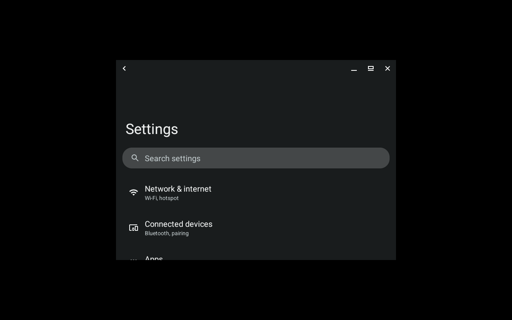
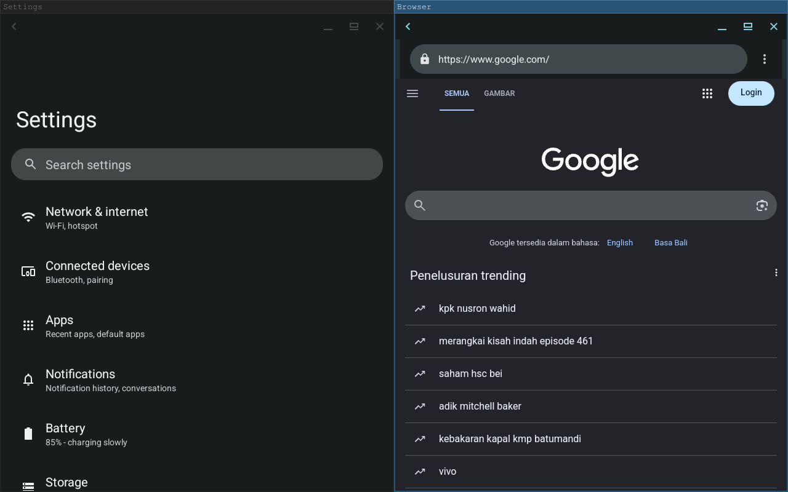
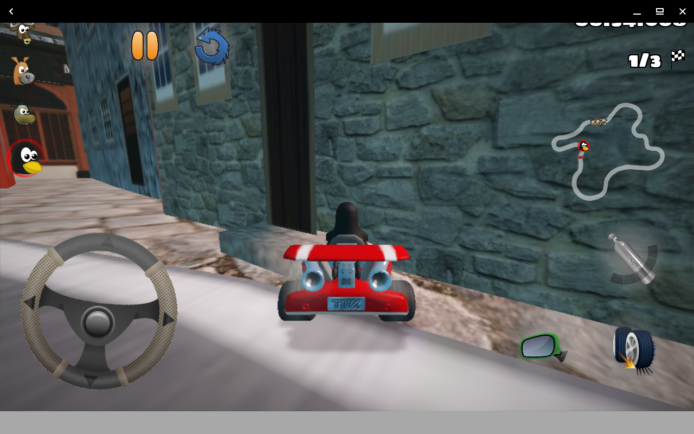
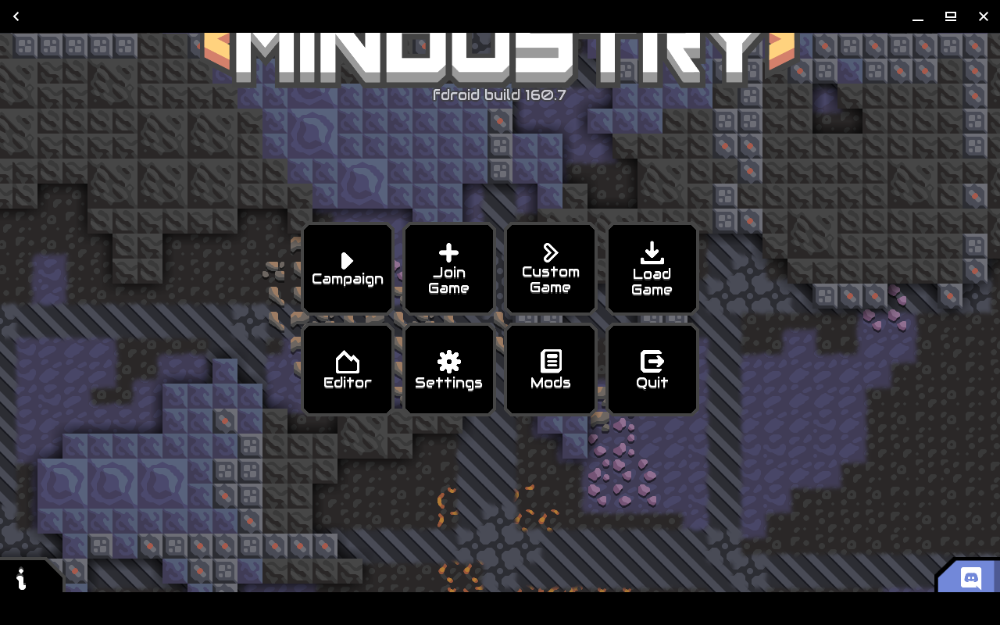
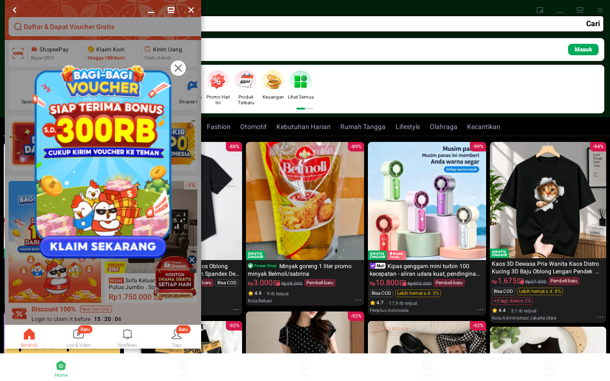

# lapis

[English](README.md) | **Bahasa Indonesia**

Android dengan Google Play di desktop Linux apa pun yang memakai systemd.
lapis menjalankan image Android berbasis LineageOS di dalam container
**systemd-nspawn** dengan kernel host. Sisi host hanyalah **satu binary Go
statis** ditambah beberapa unit systemd.

- Setiap aplikasi Android tampil sebagai window Wayland tersendiri di desktop.
- Akselerasi GPU lewat render node host (Mesa); audio lewat PipeWire/PulseAudio.
- Google Play dan layanan Google (image GAPPS), dengan translasi ARM opsional untuk aplikasi khusus ARM.
- Integrasi menu aplikasi, notifikasi desktop, sinkronisasi clipboard, adb, freeze otomatis saat suspend.


## Inspirasi

lapis terinspirasi dari [Waydroid](https://waydro.id) dan menjalankan image
container LineageOS yang sama, tetapi merupakan implementasi terpisah **tanpa
LXC dan tanpa Python**. Sebagai gantinya lapis memakai:

- **systemd-nspawn** sebagai runtime container, dikelola oleh unit systemd
  (layanan kontrol dengan socket activation, unit container `Type=notify`,
  cgroup freezer, `DevicePolicy=closed`);
- **implementasi binder murni Go** (tanpa libgbinder) untuk layanan host yang
  diajak bicara Android: daftar dan peluncuran aplikasi, notifikasi, clipboard,
  event daya;
- **jaringan bawaan** dalam Go: NAT nftables lewat netlink, server DHCP dan
  DNS forwarder sendiri (tanpa dnsmasq, tanpa skrip iptables), terintegrasi
  dengan firewall Docker;
- **filter seccomp BPF mentah** dan shim PID-1 kecil, keduanya di binary yang sama;
- **satu binary statis** (`CGO_ENABLED=0`, amd64 dan arm64), dirilis sebagai
  tarball, `.deb`, `.rpm`, paket Arch, atau image systemd-sysext.

## Kebutuhan

- Kernel dengan binder (`CONFIG_ANDROID_BINDER_IPC` + `CONFIG_ANDROID_BINDERFS`,
  atau modul `binder_linux`). Kernel bawaan Arch dan `-zen` sudah memilikinya,
  Ubuntu menyediakannya sebagai modul; kernel SteamOS tidak.
- systemd ≥ 250 dengan `systemd-nspawn` (paket `systemd-container` di Debian,
  Ubuntu, dan Fedora), util-linux.
- Sesi Wayland.

Jalankan `lapis doctor` untuk memeriksa host.

## Instalasi

Pilih salah satu:

```sh
# Paket dari rilis (https://github.com/igos-nusantara/lapis/releases) atau dist/
sudo apt install ./lapis_*_amd64.deb          # Debian/Ubuntu (ikut memasang systemd-container)
sudo dnf install ./lapis-*.x86_64.rpm         # Fedora
sudo pacman -U lapis-*-x86_64.pkg.tar.zst     # Arch

# Sistem berbasis image (SteamOS, Fedora Atomic): systemd-sysext
sudo mkdir -p /var/lib/extensions
sudo tar -C /var/lib/extensions -xzf lapis-sysext-*-amd64.tar.gz
sudo systemd-sysext refresh && sudo systemctl daemon-reload
sudo systemctl enable --now lapis-control.socket

# Atau langsung dari binary
sudo ./lapis install
```

## Penggunaan

```sh
sudo lapis init -type GAPPS            # unduh Android (~1,3 GB)
systemctl --user start lapis-session   # atau: lapis session start
lapis app list
lapis app launch com.android.vending
lapis show-full-ui                     # seluruh desktop Android dalam satu window
```

Aplikasi juga muncul di menu aplikasi desktop (`lapis.<package>.desktop`).

### Tata letak tablet atau phone

Android memilih tata letak berdasarkan smallest width layar. Default lapis
adalah **tablet**: density 160 dan setiap aplikasi dibuka maximized sesuai
ukuran display, sehingga aplikasi memakai tata letak tablet (settings dua
panel, daftar lebar).

```sh
lapis display                  # tampilkan mode saat ini
sudo lapis display phone       # tata letak phone, window seukuran phone
sudo lapis display tablet      # kembali ke default
sudo lapis display 200         # density kustom
sudo lapis display freeform    # mode tetap, tetapi aplikasi tidak di-maximize
```

Atau di `/var/lib/lapis/lapis.toml`:

```toml
[display]
mode = "tablet"        # "tablet" atau "phone"
# density = 200        # dpi, menimpa mode
# windows = "maximized" # atau "freeform"
```

Restart sesi untuk menerapkan.

### Ukuran window

Window host setiap aplikasi seukuran aplikasinya, dan aplikasi mengikuti
window-nya: ubah ukurannya, maximize, atau biarkan window manager tiling
menatanya, maka aplikasi Android akan menata ulang tampilannya ke ukuran itu.
Di mode tablet aplikasi dibuka maximized, di mode phone dengan ukuran phone.
lapis melakukannya dengan proxy Wayland kecil di antara Android dan
compositor, yang juga mencegah compositor mengubah ukuran seluruh display
Android. Untuk perilaku asli image (setiap window seukuran display, tetap):

```sh
sudo lapis display full    # atau: fit (default)
```





### Keyboard layar

Android menganggap keyboard desktop sebagai keyboard fisik, jadi lapis
menyembunyikan keyboard layar Android dan Anda mengetik dengan keyboard
host. Untuk tetap menampilkannya, atur ini di `/var/lib/lapis/lapis.toml`
lalu jalankan `lapis restart`:

```toml
[input]
soft_keyboard = true
```

### GPU dan game

lapis memberikan render node host ke Android, yang merender dengan Mesa
(AMD, Intel, dan driver Mesa lain; driver proprietary NVIDIA kembali ke
software rendering). Game berjalan di window masing-masing, termasuk game
yang menggambar ke surface terpisah (SDL dan engine sejenis): lapis memuat
library kecil ke layanan display Android yang mengaitkan surface tersebut ke
window aplikasinya. SuperTuxKart 3D pada 60 fps:





### Aplikasi sehari-hari

Aplikasi belanja dan aplikasi khusus ARM lainnya berjalan dengan translasi
ARM (lihat di bawah). Shopee (portrait, window seukuran ponsel) dan Tokopedia
(tata letak tablet) berdampingan:



### Sertifikasi Google Play

```sh
sudo lapis gapps-id
```

Daftarkan id yang tercetak di <https://www.google.com/android/uncertified>,
lalu hapus data Play Store atau restart sesi.

### Aplikasi khusus ARM

```sh
sudo lapis extras install libhoudini   # menjalankan aplikasi terbanyak, di Intel dan AMD
systemctl --user restart lapis-session
```

`libndk` adalah alternatifnya (lebih cepat di AMD), tetapi beberapa aplikasi
berhenti paksa dengannya; Tokopedia misalnya hanya berjalan dengan
`libhoudini`. Pasang salah satu saja.

### Perintah lain

| Perintah | Fungsi |
|---|---|
| `lapis status` | status container |
| `lapis freeze` / `unfreeze` | jeda Android (otomatis saat host sleep) |
| `lapis adb connect` | otorisasi key adb dan sambungkan |
| `sudo lapis shell`, `sudo lapis logcat` | debugging |
| `sudo lapis upgrade` | perbarui image Android |

## Pengembangan

```sh
go test ./...
scripts/release.sh                      # dist/: tarball, deb, rpm, Arch, sysext
git tag v0.6.0 && git push origin v0.6.0  # CI membangun dan merilis semua paket
test/e2e/vm.sh start                    # VM Arch (KVM, di podman) untuk uji end-to-end
test/e2e/all.sh                         # semua fase, end to end
```

Lihat [PLAN.md](PLAN.md) (bahasa Inggris) untuk desain dan hasil pengujian,
serta [AGENTS.md](AGENTS.md) untuk panduan kontribusi.

## Lisensi

MIT, lihat [LICENSE](LICENSE).
