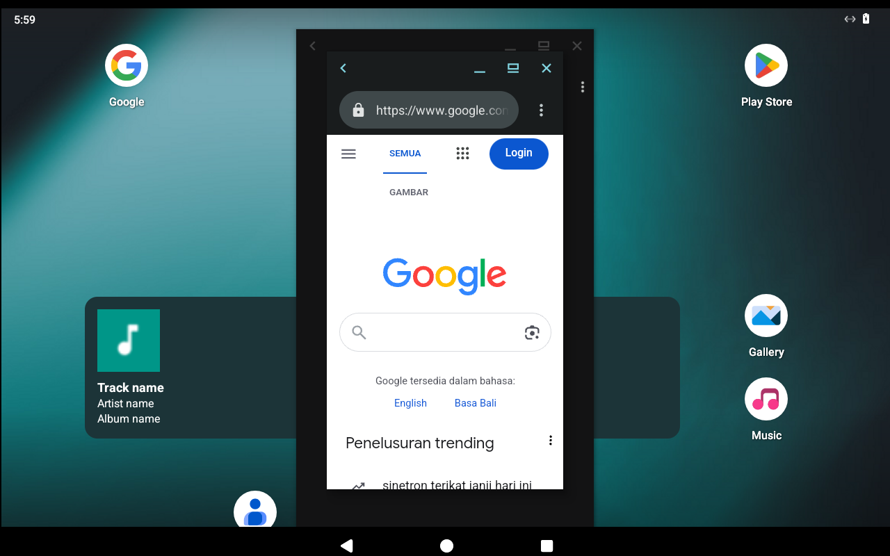
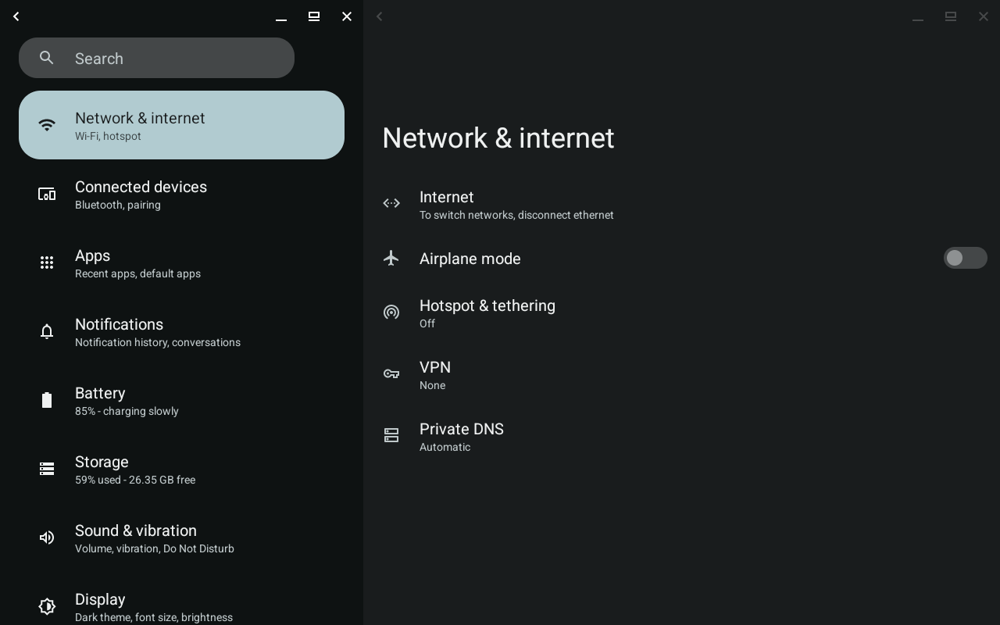
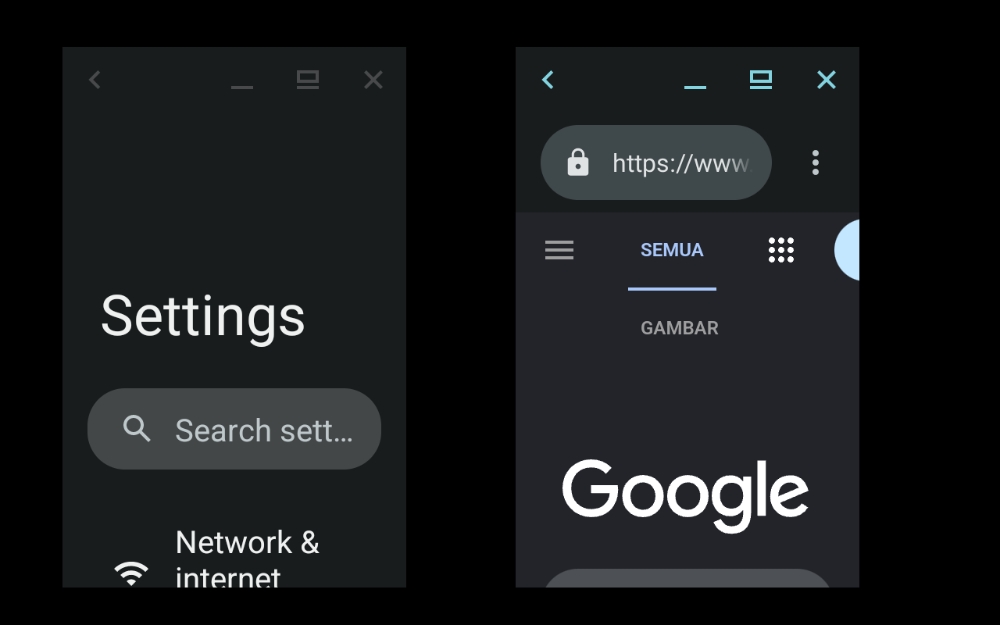

# lapis

Android with Google Play on any systemd-based Linux desktop. lapis boots a
LineageOS-based Android image inside a **systemd-nspawn** container on the host
kernel. The host side is a **single static Go binary** plus a few systemd units.

- Each Android app is its own Wayland window on your desktop.
- GPU acceleration through the host render node (Mesa); audio through PipeWire/PulseAudio.
- Google Play and Google services (GAPPS image), with optional ARM translation for ARM-only apps.
- App menu integration, desktop notifications, clipboard sync, adb, automatic freeze on suspend.







## Inspiration

lapis is inspired by [Waydroid](https://waydro.id) and boots the same
LineageOS container images, but it is a separate implementation with **no LXC
and no Python**. Instead it works with:

- **systemd-nspawn** as the container runtime, managed by systemd units
  (socket-activated control service, `Type=notify` container unit, cgroup freezer,
  `DevicePolicy=closed`);
- a **pure-Go binder implementation** (no libgbinder) for the host services
  Android talks to: app list and launching, notifications, clipboard, power events;
- **built-in networking** in Go: nftables NAT over netlink, its own DHCP server and
  DNS forwarder (no dnsmasq, no iptables scripts), with Docker firewall integration;
- a **raw BPF seccomp filter** and a tiny PID-1 shim, both in the same binary;
- **one static binary** (`CGO_ENABLED=0`, amd64 and arm64), shipped as a tarball,
  `.deb`, `.rpm`, Arch package or systemd-sysext image.

## Requirements

- A kernel with binder (`CONFIG_ANDROID_BINDER_IPC` + `CONFIG_ANDROID_BINDERFS`,
  or the `binder_linux` module). Arch's stock and `-zen` kernels have it built in,
  Ubuntu ships it as a module; the SteamOS kernel does not.
- systemd ≥ 250 with `systemd-nspawn` (package `systemd-container` on Debian,
  Ubuntu and Fedora), util-linux.
- A Wayland session.

Run `lapis doctor` to check a host.

## Install

Pick one:

```sh
# Packages from dist/
sudo apt install ./lapis_*_amd64.deb          # Debian/Ubuntu (pulls systemd-container)
sudo dnf install ./lapis-*.x86_64.rpm         # Fedora
sudo pacman -U lapis-*-x86_64.pkg.tar.zst     # Arch

# Image-based systems (SteamOS, Fedora Atomic): systemd-sysext
sudo mkdir -p /var/lib/extensions
sudo tar -C /var/lib/extensions -xzf lapis-sysext-*-amd64.tar.gz
sudo systemd-sysext refresh && sudo systemctl daemon-reload
sudo systemctl enable --now lapis-control.socket

# Or straight from the binary
sudo ./lapis install
```

## Use

```sh
sudo lapis init -type GAPPS            # download Android (~1.3 GB)
systemctl --user start lapis-session   # or: lapis session start
lapis app list
lapis app launch com.android.vending
lapis show-full-ui                     # whole Android desktop in one window
```

Apps also appear in the desktop's app menu (`lapis.<package>.desktop`).

### Tablet or phone layout

Android picks its layout from the screen's smallest width. lapis defaults
to **tablet**: density 160 and every app opened maximized to the display, so
apps use their tablet layouts (two-pane settings, wide lists).

```sh
lapis display                  # show the current mode
sudo lapis display phone       # phone layout, phone-sized app windows
sudo lapis display tablet      # back to the default
sudo lapis display 200         # custom density
sudo lapis display freeform    # keep the mode, but don't maximize apps
```

Or in `/var/lib/lapis/lapis.toml`:

```toml
[display]
mode = "tablet"        # "tablet" or "phone"
# density = 200        # dpi, overrides mode
# windows = "maximized" # or "freeform"
```

Restart the session to apply.

### Window size

Each app's host window is as large as the app: in tablet mode that is the
whole display (apps are maximized), in phone mode the phone-sized app window.
lapis does this with a small Wayland proxy between Android and your
compositor; it also keeps the compositor from resizing the Android display.
Floating desktops (KDE, GNOME) show each app at its size; on tiling window
managers apps keep their size inside the tile, so a tile smaller than the
app crops it. To get the images' original behavior (every window as large
as the display):

```sh
sudo lapis display full    # or: fit (default)
```

### Google Play certification

```sh
sudo lapis gapps-id
```

Register the printed id at <https://www.google.com/android/uncertified>,
then clear the Play Store's data or restart the session.

### ARM-only apps

```sh
sudo lapis extras install libndk     # AMD CPUs (or libhoudini on Intel)
systemctl --user restart lapis-session
```

### Other commands

| Command | Purpose |
|---|---|
| `lapis status` | container state |
| `lapis freeze` / `unfreeze` | pause Android (done automatically when the host sleeps) |
| `lapis adb connect` | authorize your adb key and connect |
| `sudo lapis shell`, `sudo lapis logcat` | debugging |
| `sudo lapis upgrade` | update the Android images |

## Development

```sh
go test ./...
scripts/release.sh                      # dist/: tarballs, deb, rpm, Arch, sysext
test/e2e/vm.sh start                    # Arch VM (KVM, in podman) for end-to-end tests
test/e2e/all.sh                         # every phase, end to end
```

See [PLAN.md](PLAN.md) for the design and the test results.

## License

MIT, see [LICENSE](LICENSE).
